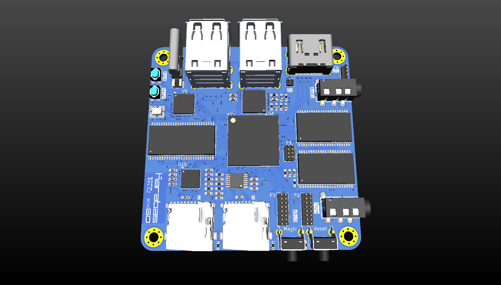
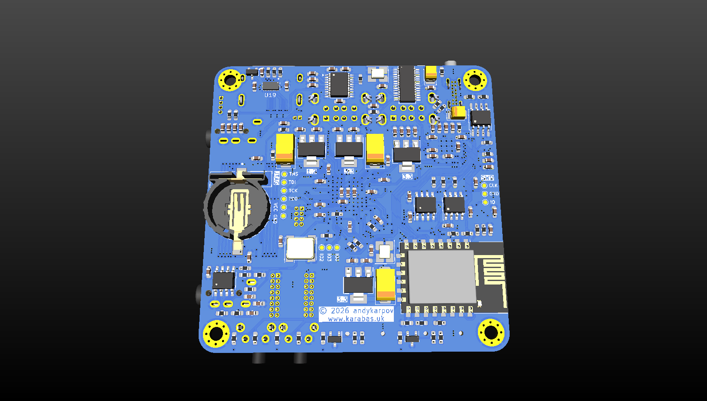
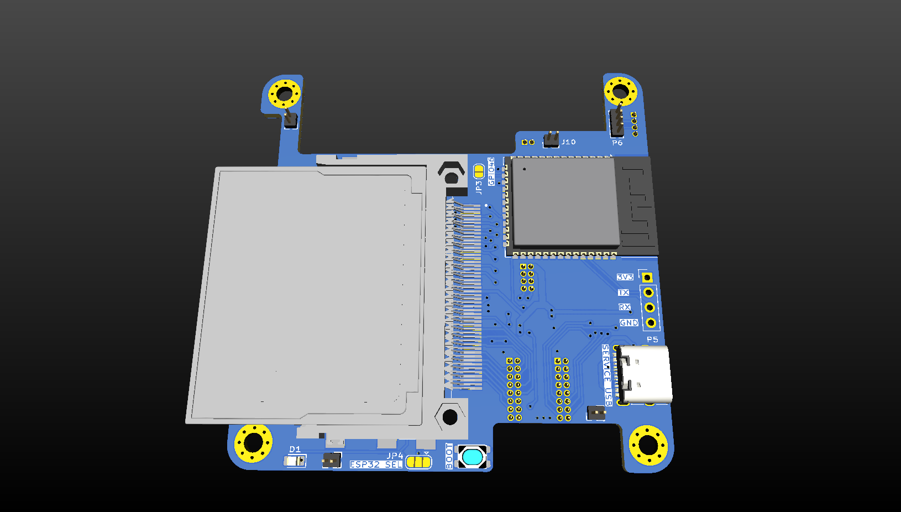
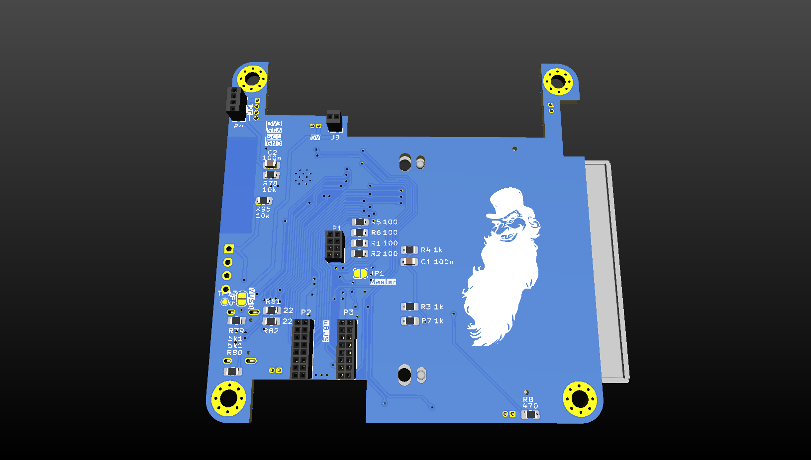
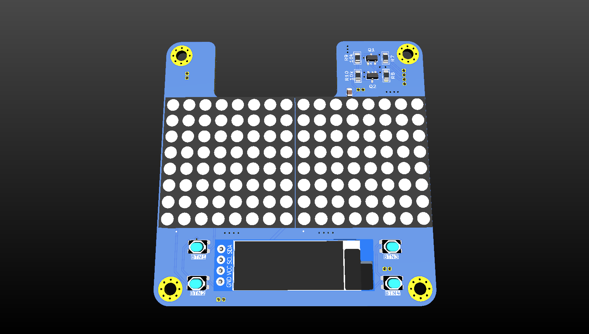
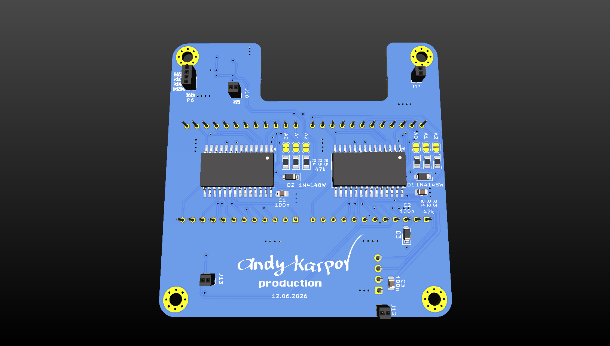

# Karabas-Go Mini

> **This repository is archived.** Karabas Mini and Mini G now live in
> [karabas-go](https://github.com/andykarpov/karabas-go), the repository of the whole family:
> the cores (`cores/*.kg`, one file for all the boards), the firmware (`firmware/karabas_mini.uf2`
> for rev.C - rev.F3, `firmware/karabas_minig.uf2` for rev.G / G2, the ESP32-S3 files), the
> docs, gerbers and cases of the Mini (`docs/mini`, `pcb/mini`, `case/mini`), the first start
> (`docs/howto.md`). The files here are not updated any more: the firmware here does not read
> the current cores.
>
> **Репозиторий в архиве.** Karabas Mini и Mini G теперь в
> [karabas-go](https://github.com/andykarpov/karabas-go), общем репозитории всего семейства:
> ядра (`cores/*.kg`, один файл для всех плат), прошивка (`firmware/karabas_mini.uf2` для
> rev.C - rev.F3, `firmware/karabas_minig.uf2` для rev.G / G2, файлы ESP32-S3), документация,
> гербера и корпуса Mini (`docs/mini`, `pcb/mini`, `case/mini`), первый запуск
> (`docs/howto.md`). Файлы здесь больше не обновляются: прошивка отсюда не читает нынешние ядра.

A Spartan-6 based devboard to emulate different retro-computers.

The hardware design and documentation are licensed under [Creative Commons Attribution-NonCommercial-ShareAlike 4.0 International](http://creativecommons.org/licenses/by-nc-sa/4.0/).

FPGA cores, the firmware and other software parts are licensed by their own licenses.

### What's on the board:

- A 25k LE's Spartan-6 FPGA
- RP2040 MCU
- 4x USB Ports
- 2x 2MB 10ns SRAM chips
- 32MB SDRAM chip
- DVI output
- On-board FT812 video processor
- SAM2695 midi synth
- 2x microSD cards
- Tape In/Out interface
- DS3221 RTC
- 1kB EEPROM
- ESP8266 Wi-Fi module
- uBUS expansion connector
- ESP32-S3 as VDAC32 mcu
- CF card

### PCB 

The latest stable PCB revision number is Rev.G.

Warning: RevC,D,F requires a small [HW mod](https://github.com/andykarpov/karabas-mini/blob/master/revF_mod.md)

PCB source project: https://github.com/andykarpov/karabas-mini-pcb

### Pre-production renders:

### Shield with CF card and ESP32-S3 for rev.G (2nd floor)

### Shield for v4 shield with Dot matrix display (3rd floor)

